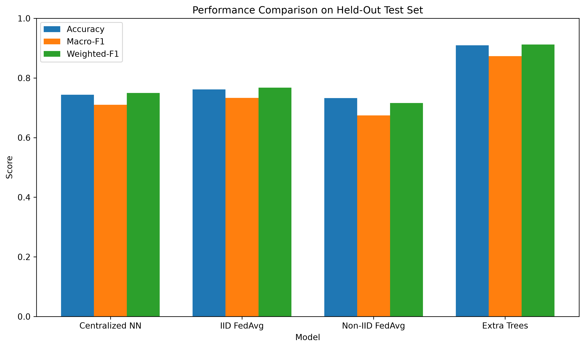
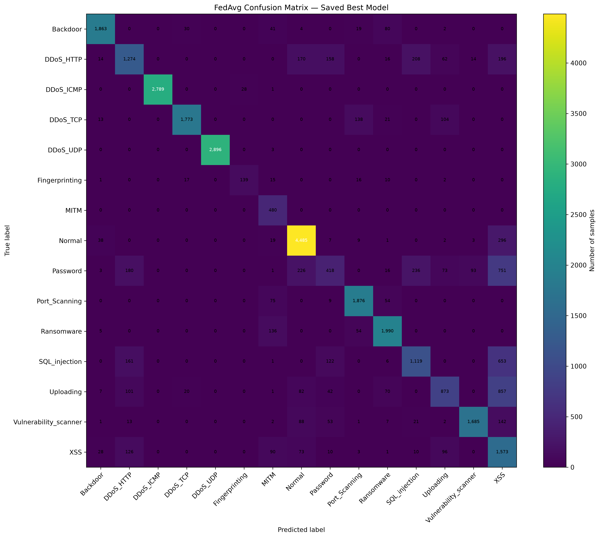
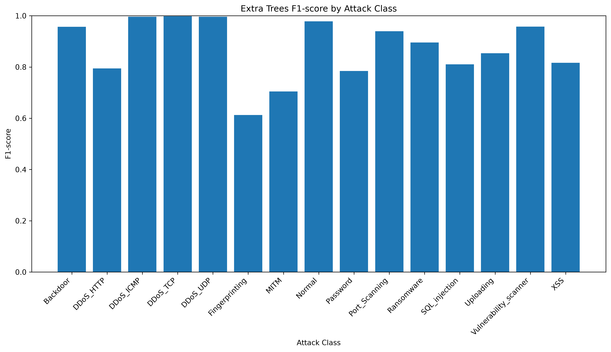
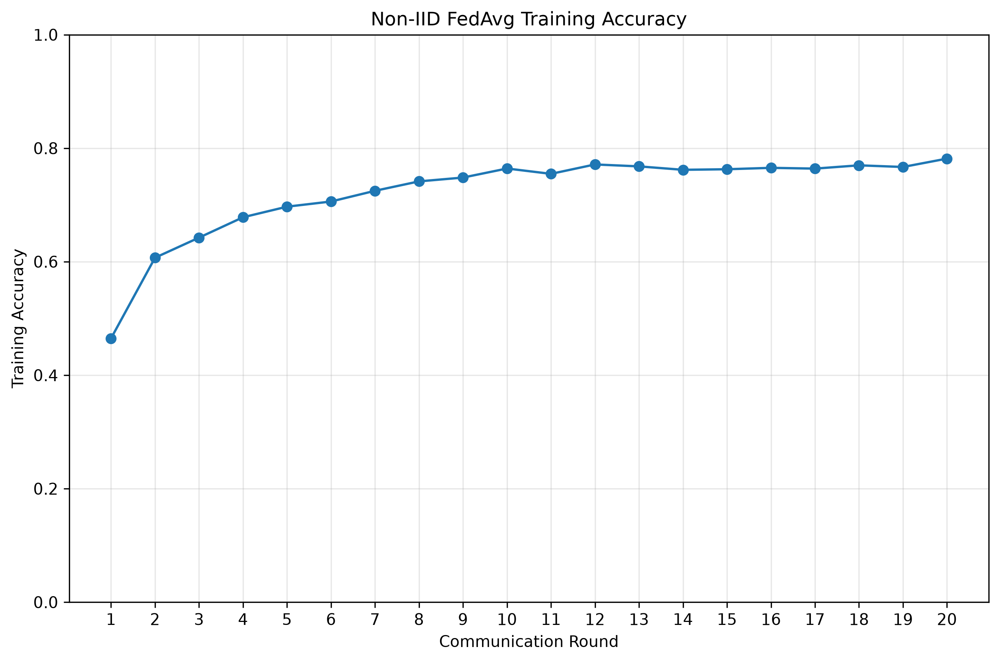

# Federated IIoT Threat Detection

A simulated federated learning framework for detecting cyber threats in Industrial Internet of Things (IIoT) network traffic using non-IID client data.

## Overview

Industrial Internet of Things (IIoT) systems connect industrial devices, communication networks, and control systems. Detecting malicious network activity is important for maintaining the security and reliability of these environments.

This project investigates **Federated Averaging (FedAvg)** with a neural network to classify normal traffic and different attack categories. Training data is distributed across three simulated clients with non-IID data distributions.

The objective is to evaluate how federated training performs compared with centralized learning and a conventional machine-learning baseline.

## Key Features

- Three simulated federated clients.
- Non-IID data partitioning using a Dirichlet distribution.
- FedAvg aggregation based on client dataset sizes.
- Neural network with two hidden layers.
- Training on CPU using PyTorch.
- Evaluation on a fixed held-out test set.
- Per-class precision, recall, and F1-score analysis.
- Confusion matrix and model-comparison visualizations.

## Dataset

**Dataset:** Edge-IIoTset

The project uses the selected ML/DL CSV dataset, with `Attack_type` as the classification target.

| Dataset component | Records |
|---|---:|
| Global training data | 126,007 |
| Client 1 training subset | 36,043 |
| Client 2 training subset | 24,428 |
| Client 3 training subset | 27,733 |
| Held-out test set | 31,793 |
| Input features | 34 |
| Target classes | 15 |

The three client subsets contain 88,204 records in total. The held-out test set remains separate from client training.

The preprocessing pipeline handles missing and infinite values, imputes missing values using training-set medians, and applies standard scaling. Identifier and raw-payload fields were excluded during feature preparation.

The dataset is not included in this repository by default. Obtain it from its original source and follow its applicable terms of use.

## Methodology

### 1. Data preparation

The selected dataset is cleaned and divided into training and testing data. Training records are distributed among three simulated clients with non-IID class distributions.

### 2. Local model training

Each client trains the same feed-forward neural network using its local data.

**Network architecture**

- Input layer: 34 features
- Hidden layer 1: 128 neurons with ReLU activation
- Dropout: 0.2
- Hidden layer 2: 64 neurons with ReLU activation
- Dropout: 0.2
- Output layer: 15 classes

The network uses the Adam optimizer and a weighted cross-entropy loss function.

### 3. Federated aggregation

The server combines client model parameters using sample-size-weighted FedAvg aggregation. The experiment uses 20 communication rounds and 10 local epochs per client.

### 4. Evaluation

The final global model is evaluated on the held-out test set using accuracy, macro-F1, weighted-F1, and per-class classification metrics. A confusion matrix is generated to examine classification errors.

This is a simulation of federated learning rather than a deployment across physically separate devices. Some preprocessing and class-weight calculations use pooled training data, so the implementation should not be interpreted as a fully decentralized production system.

## Results

### Best saved FedAvg model

| Metric | Test result |
|---|---:|
| Accuracy | 79.37% |
| Macro-F1 | 76.41% |
| Weighted-F1 | 79.17% |

These results correspond to the saved experiment using three clients, 20 communication rounds, 10 local epochs, and 34 input features.

### Baseline comparison

| Model | Accuracy | Macro-F1 |
|---|---:|---:|
| Centralized Neural Network | 74.37% | 70.99% |
| IID FedAvg | 76.16% | 73.31% |
| Non-IID FedAvg baseline | 73.24% | 67.43% |
| Extra Trees | 90.96% | 87.30% |
| Best saved non-IID FedAvg | 79.37% | 76.41% |

The best saved FedAvg result improves on the listed centralized neural-network and initial non-IID FedAvg baselines. Extra Trees achieves higher performance, showing that the federated neural-network approach still has room for improvement.

Results should be interpreted in the context of the chosen dataset, preprocessing pipeline, and simulated client configuration.

## Visualizations

Generated figures are stored in `results/figures/`.

- `model_comparison.png` — comparison of baseline model metrics.
- `extra_trees_per_class_f1.png` — per-class F1-scores for Extra Trees.
- `extra_trees_confusion_matrix.png` — Extra Trees confusion matrix, if its source data is available.
- `fedavg_best_confusion_matrix.png` — confusion matrix for the saved best FedAvg model.
- `fedavg_noniid_training_loss.png` — non-IID FedAvg training-loss history.
- `fedavg_noniid_training_accuracy.png` — non-IID FedAvg training-accuracy history.

The FedAvg confusion matrix is also saved as `results/fedavg_best_confusion_matrix.csv`.

## Project Structure

```text
Federated-IIoT-Threat-Detection/
├── data/
│   └── processed/
├── experiments/
├── models/
├── results/
│   ├── figures/
│   └── fedavg_best_confusion_matrix.csv
├── src/
│   ├── data/
│   ├── federated/
│   ├── models/
│   └── visualization/
├── tests/
├── .gitignore
├── README.md
└── requirements.txt
```

## Technologies

- Python 3.11
- PyTorch
- pandas and NumPy
- scikit-learn
- Matplotlib
- Git and GitHub
- VS Code

## Running the Project

Create and activate a Python virtual environment, install the dependencies, prepare the dataset, and run the relevant scripts from the project root.

Install dependencies:

```bash
pip install -r requirements.txt
```

Prepare the federated data using the data-preparation scripts under `src/data/`.

Run the non-IID FedAvg training experiment:

```bash
python src/federated/fedavg_noniid_e3.py
```

**Note:** This command starts a new training run and overwrites the generic FedAvg outputs. It is not required to view the existing results or generate the confusion matrix from the saved checkpoint.

Generate the saved-model confusion matrix without retraining:

```bash
python src/visualization/generate_fedavg_confusion_matrix.py
```

Run commands from the repository root. Check each script's input paths and dependencies before execution.

## Limitations and Future Work

Current limitations include lower detection performance for certain classes, especially Password, Uploading, XSS, and SQL injection. The experiments also use a simulated federated environment and centralized preprocessing statistics.

Potential future work includes:

- Improving minority-class detection.
- Evaluating additional non-IID partition settings.
- Comparing alternative aggregation methods.
- Investigating communication cost and client-level performance.
- Evaluating privacy-preserving mechanisms.
- Testing on additional IIoT intrusion-detection datasets.

## Research Purpose

This project is intended as a research and portfolio implementation for studying federated learning, network traffic classification, and IIoT cybersecurity. Reported performance represents experimental results and does not establish production readiness.
## Experimental Results and Visualizations

### 1. Model Performance Comparison

The following figure compares the performance of the evaluated models, including the federated learning approaches and the Extra Trees baseline.



### 2. Best FedAvg Model: Confusion Matrix

The confusion matrix shows the classification performance of the selected non-IID FedAvg model on the held-out test set.



The selected model achieved:
- **Accuracy:** 79.37%
- **Macro-F1:** 76.41%
- **Weighted-F1:** 79.17%

### 3. Per-Class Performance

This figure presents the F1-score for individual classes using the Extra Trees baseline, helping identify classes that are easier or more difficult to classify.



### 4. Non-IID Federated Training

The following figure shows the training accuracy across communication rounds for the non-IID federated learning experiment.



### Experimental Note

The experiments use simulated federated clients created from the Edge-IIoTset dataset. The results are specific to the selected preprocessing, data split, model configuration, and random seed. The federated setup is a research simulation, not a deployment on physical IIoT devices.

